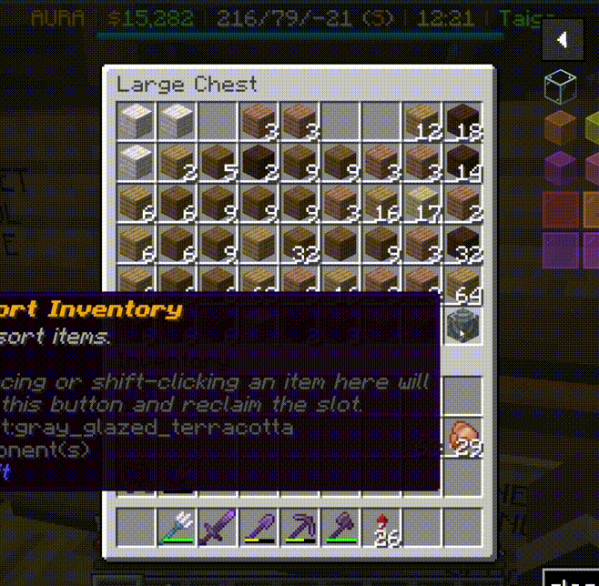

Download Aura Server QoL Plugin from these trusted hosts!

 

# 
AuraServerQoL

Each feature can be disabled/adjusted in the config.

 

**AuraServerQoL** is a lightweight, server-side Paper plugin designed to bring essential Quality-of-Life (QoL) features and smooth mechanics to your Minecraft server—**without requiring your players to install any client-side mods!**
 

<b>Optional Integrations</b>

  | 
Vault
 | 
PlaceholderAPI
 |
| :--- | :--- |

  Please report any found bugs on GitHub or Discord!  
  
  &nbsp;&nbsp;
  

## 🚀 Why Download AuraServerQoL?

* **100% Vanilla Client Compatible:** Deliver popular modded-style features to your players without forcing players to install Fabric, Forge, or client mods. Bridging the gap for console players or players that just don't know how to install mods.
* **Fully Configurable:** Every module can be toggled or tuned inside `config.yml`. Don't want boat jumping or dynamic lighting on your server? Simply switch them to `false`!
* **Optimized for Paper:** Built asynchronously and thread-safe from the ground up to prevent tick lag, or server performance dips.

  

## 
🌟AuraServerQoL Features

#### _**Dynamic Lighting**_

Activated by the player holding a light source such as a torch/lantern/glowstone/etc. in their mainhand or off-hand. Normally a feature that is limited to those clients with loaded shaders or client-side mods. We change that requirement allowing anyone that joins your server to enjoy the feature. Light brightness is equivalent to the held item's light output vanilla value.
  * **Flares Update** (ASQoL v1.3.0+) - Dynamic Lighting now follows player dropped light sources for a flare effect that burns out after 30 seconds.

#### _**Auto Tool Replacement**_

Automatically swaps broken tools with a fresh matching tool or sword from the player's inventory or hotbar so mining, farming, and combat remain seamless.

#### _**Boat Jumping/Hurdling**_

Improved boat navigation! Automatic Hurdling makes navigating the waters a lot easier. Boats will pull themselves over obstacles like ice/shore banks/lilypads. Additionally, players can manually launch boats over 1-block obstacles by pressing the **Swap Hands Key (F)**. Tunable settings in the config file.
  * _Manual jump not compatible with Bedrock clients_

#### _**Custom Day/Night Cycles**_

You are in control of the days and the nights. Whether you like to play with 20 minute days and 5 minute nights, or you want longer nights and shorter days. Set how long you want your Day/Night cycles to be and change it whenever you want.
  * Set custom broadcast messages to the server when daytime and nighttime starts. 

#### _**Portable Item Disposal**_

Open a safe item disposal window by right-clicking on a Lava Bucket, allowing players to permanently purge unwanted junk items from their inventories without dropping items on the ground.

#### _**Container/Chest Sorting**_

An item sort button populates in the lower-right inventory slot for chests, barrels, shulker boxes, etc. When clicked the items inside of the chest are consolidated into their maximum stacks and sorted into groups of alike items. The sort items can be placed in the same slot as the sort button so you do not lose an inventory slot because of the button. 

#### _**Item Salvage**_

Sneak and Right-Click any Grindstone to open an Item Salvage interface. Craftable items can be broken down into their recipe ingredients and given back to the player.

#### _**Fully Customizable Player HUD**_

Allows you to set a Bossbar heads up display for your players that activates for them when they join your server. Change colors, text, layout, formatting. This is the perfect addition to give your players extra information at a glance without them having to install any client side mods. 
  * Added Vault API to plugin to support economy display in the HUD.
  * Preconfigured display placeholders: {afk}, {balance}, {biome}, {brand}, {coords}, {currency}, {direction}, {separator}, {time}. Each allows for custom colors using HEX, Color Codes, and standard color names.
  * Added PlaceholderAPI to plugin to support adding custom placeholders to the HUD from other plugins. 
  * Layout section of the config allows for even further customization, not restricted to only using placeholders, it also supports color codes if you just want to use it for a message.
  * Players can toggle the hud using (`/aurahud`) to turn off/on the HUD at will. Preferences are saved for each user.

#### _**Automatic Crop Replanting**_

When players right click to harvest crops, the crop is automatically replanted if the player has the seed/crop necessary to replant in their inventory.

#### _**Farming Earns XP**_

Players are awarded with XP when they harvest crops. XP amount is configurable by min and max values, awarded xp is randomized between those values.

#### _**Mob Shields**_

Admins can create Mob Shields allowing for safe areas that mobs are not allowed to enter. Fully customizable in size, location, naming, and entity whitelisting. Use the command to disable/enable, add/delete, specific shields. Whitelisting entities can be set globally and each shield can have it's own optional whitelist to allow specific mobs access (in addition to the primary global whitelist)

#### _**Safe Fall Distance**_

Set how many blocks a player can fall before they take fall damage.

#### _**Automatic/Manual AFK Detection**_

Detect player AFK status and broadcast a server message when a player enters afk and returns from being afk.
  * Added mostly to support AuraSleep logic. You can choose to use the built-in AFK detection or hook into your favorite AFK detector such as EssentialsX, CMI, Purpur, or detection using PlaceholderAPI. Of course, the feature can be disabled entirely as well.
  * Players can set themselves as AFK using (`/auraafk`) if using the built-in aura detection.

#### _**Custom Sleep Logic**_

Fully customize the sleep requirements and restrictions on your server. With an AFK provider set, or by using the built-in option, you no longer have to wait for AFK players to go to their beds to skip the night or thunderstorms.
  * Set the percentage of players required to skip the night. The percentage can be adjusted based on the number of players on the server so that a smaller percentage is required when more players are online.
  * Custom broadcast message after sleep threashold is met to skip night.

#### _**Ignore Hostile mobs**_

Stop mobs from preventing players from sleeping in beds.

#### _**Share Beds**_

Allows multiple players to sleep in a single bed.

#### _**Rest Reset Everyone**_

When the sleep threashold is met to skip the night, you can apply rest to every online player even if they did not sleep in a bed. Preventing players from being harassed by Phantoms because they didn't sleep.

---

<b>📋 Permissions & Commands</b>

| Command | Permission | Description | Default State |
| :--- | :--- | :--- | :--- |
| `/aurahud` | `auraserverqol.hud` | Toggle the AuraHUD feature. | `true` |
| `/auraafk` | `auraserverqol.afk` | Toggle AFK status (when using the `aura` provider in config). | `true` |
| `/auralights` | `auraserverqol.lights` | Toggle the dynamic lighting feature. | `true` |
| `/auradisposal` | `auraserverqol.disposal` | Opens portable item disposal when holding a lava bucket in inventory. Added for Bedrock compatibility. | `true` |
| `/auratoolbreak` | `auraserverqol.auratoolbreak` | Toggle the automatic tool replacement feature. | `true` |
| `/aurasort` | `auraserverqol.aurasort` | Toggle the item sort button inside containers. | `true` |
| `/aurabook` | `auraserverqol.book` | Gives the player a reference book covering features and player commands. | `true` |
| `/aurashield` | `auraserverqol.shield` | Create, delete, list, and toggle mob shield zones at your location using `/aurashield create <name/id> <radius>` (fine-tune in `shields.yml`). | `op` |
| `/auraserverqol <reload\|info\|update>` | `auraserverqol.admin` | Manage plugin reloads, view info, check updates, and receive update notifications. | `op` |

<b>⚙️ Current config.yml</b>

[Updated config.yml Reference](https://www.oneeyebear.net/asqol-config)

